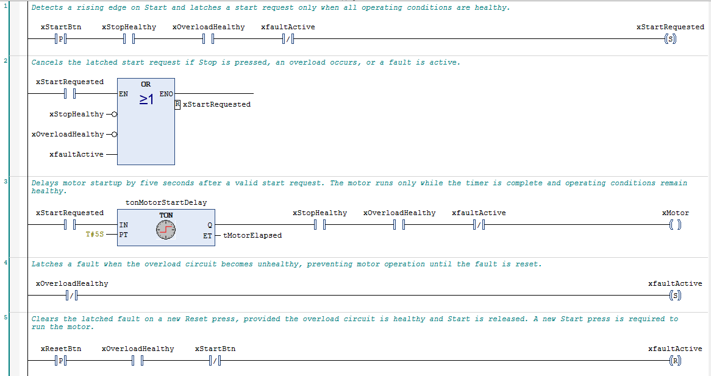

# Motor Start/Stop Control with Overload Protection

This project simulates an industrial motor-control system using Ladder Logic in CODESYS. The program implements motor start/stop control, a five-second startup delay, simulated overload protection, and a fault-latching mechanism with manual reset. For clarification, overload is in reference to the motor drawing more current than safely rated.

The goal of this project was to develop a reliable motor-control sequence while gaining practical experience with PLC programming concepts, including rising-edge detection, Set/Reset coils, Boolean operators, timers, and interlocking conditions.

The program was developed and tested entirely using the CODESYS simulation environment, without physical PLC hardware.

## Prerequisites

To run this project, you will need:

- [CODESYS Development System](https://www.codesys.com/)
- CODESYS simulation mode

No physical PLC or motor hardware is required.

## System Description

The system controls a simulated motor using Start and Stop commands, overload relay feedback, and a manual fault reset.

When the Start button is pressed, the program checks whether the Stop circuit and overload relay are healthy and whether any fault is active.

If all operating conditions are satisfied, a start request is latched and a five-second timer begins counting. Once the timer finishes, the motor is activated.

If the Stop button is pressed or an overload occurs, the motor is immediately disabled and the start request is cancelled.

An overload additionally activates a latched fault, which must be manually reset before the motor can be restarted.

## Key Features

 - **Start/Stop Control**: Motor operation is initiated by a Start command and cancelled by Stop.
 - **Delayed Startup**: A five-second TON timer delays motor activation.
 - **Start Requested Latching**: A Set coil maintains the start request after the Start button is released.
 - **Overload Monitoring**: Simulated overload relay feedback prevents motor operation when an overload is detected.
 - **Fault Latching**: An overload sets a fault that remains active even after the overload condition clears.
 - **Manual Fault Reset**: The fault can only be cleared when the overload circuit is healthy and the Start button is released.
 - **Restart Prevention**: The motor requires a new Start command after a Stop or fault condition.

## Key Components

### 1. Inputs and Outputs

| Variable  | Description |
| ------------- | ------------- |
| `xStartBtn`  | Start button input; `TRUE` when pressed |
| `xStopHealthy`  | Stop circuit status; `TRUE` when the circuit is closed  |
| `xOverloadHealthy`  | Overload relay status; TRUE when no overload trip is present  |
| `xResetBtn`  | Manual fault reset button  |
| `xMotor`  | Motor control output  |

The `xStopHealthy` and `xOverloadHealthy` variables use a healthy-high convention, consistent with the expected signals from normally closed physical control contacts.

### 2. Internal Variables

| Variable  | Description |
| ------------- | ------------- |
| `xStartRequested`  | Latched start request |
| `xfaultActive`  | Latched overload fault  |
| `tonMotorStartDelay`  | TON function block instance  |
| `tMotorElapsed`  | Elapsed time of the startup timer  |

## 3. Ladder Logic Components

### Rising-Edge Contacts

Used for the Start and Reset buttons to detect new button presses. This prevents a continuously held button from repeatedly initiating its associated action.

### Set/Reset Coils

Used to retain the start request and overload fault until their respective reset conditions are satisfied.

### OR Boolean Operator

Combines three conditions that cancel the start request:

- Stop circuit unhealthy (`NOT xStopHealthy`)
- Overload circuit unhealthy (`NOT xOverloadHealthy`)
- Active fault (`xfaultActive`)

If any of these conditions occurs, `xStartRequested` is reset.

### TON (Timer ON Delay)

The `tonMotorStartDelay function` block delays motor activation by five seconds (`T#5s`).

The timer begins counting when a valid start request is active. Its `Q` output becomes `TRUE` after the preset delay and remains `TRUE` while the timer input remains active.

## How the System Works

### 1. Start Request

Pressing Start generates a rising-edge signal.

If the Stop circuit and overload relay are healthy and no fault is active, the program sets `xStartRequested` to `TRUE`.

The Set coil retains this request after the Start button is released.

### 2. Startup Delay

The latched start request enables the TON function block.

The timer counts for five seconds before allowing the motor to start.

If the start request is cancelled during the countdown, the timer resets and the motor remains OFF.

### 3. Motor Operation

Once the timer finishes, its `Q` output becomes `TRUE`.

The motor runs as long as the following conditions remain satisfied:

- The start request remains active.
- The Stop circuit is healthy.
- The overload circuit is healthy.
- No fault is active.

### 4. Stop and Overload Handling

Pressing Stop causes `xStopHealthy` to become `FALSE`.

The motor is disabled, and the start request is reset.

An overload is simulated by setting `xOverloadHealthy` to `FALSE`. This disables the motor and sets `xfaultActive` to `TRUE`.

The fault remains latched even after the overload circuit returns to its healthy state.

In an industrial application, an overload relay may trip when excessive motor current creates a risk of overheating, such as during excessive mechanical loading or a conveyor jam.

This project simulates the PLC response to an overload relay rather than measuring motor current directly.

### 5. Fault Reset and Restart

To clear an overload fault:

1. Restore `xOverloadHealthy` to `TRUE`.
2. Ensure the Start button is released.
3. Press Reset to clear `xfaultActive`.
4. Press Start again to initiate a new five-second startup sequence.
   
The motor does not automatically restart after the fault is cleared.

## Ladder Logic Implementation

The program is organized into five Ladder Logic networks:

1. **Start Request**: Detects a rising edge on Start and latches a valid start request.
2. **Request Cancellation**: Uses an OR Boolean operator to reset the request when Stop, overload, or fault conditions occur.
3. **Motor Startup Delay**: Uses a TON function block and operating permissives to control motor activation.
4. **Overload Fault Latching**: Sets a persistent fault when the overload circuit becomes unhealthy.
5. **Fault Reset**: Clears the latched fault following a valid manual Reset command.

  

## How to Run the Project

1. Install the CODESYS Development System.
2. Clone or download this repository.
3. Open the included .project file in CODESYS.
4. Enable Online → Simulation.
5. Build the project and log in to the simulated controller.
6. Download the application if prompted, then start the PLC.
7. Monitor and modify the input variables to simulate motor operation and fault conditions.

### Initial Conditions

The simulation uses the following initial input states:

| Variable  | Initial Value |
| ------------- | ------------- |
| `xStartBtn`  | `FALSE` |
| `xStopHealthy`  | `TRUE`  |
| `xOverloadHealthy`  | `TRUE`  |
| `xResetBtn`  | `FALSE`  |

To simulate pressing a button, change its Boolean value in the online monitoring interface.

To simulate an overload trip, set `xOverloadHealthy` to `FALSE`.

## Demonstration

Demo video *Coming soon*

